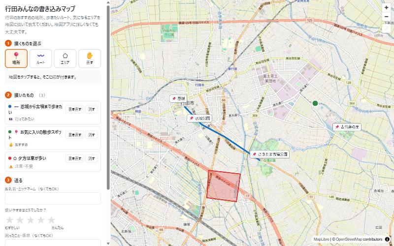
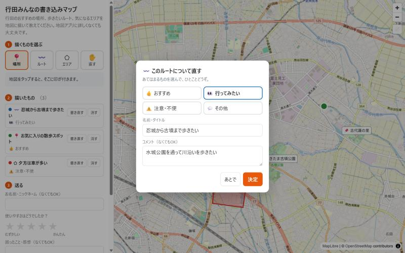
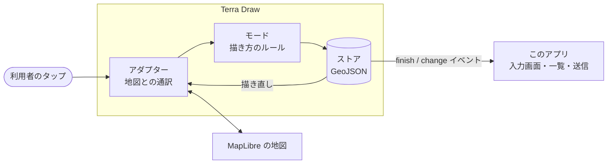
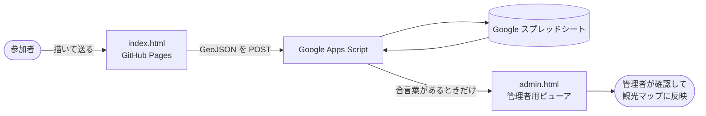

# 行田みんなの書き込みマップ

**GIS を触ったことがない人でも、地図に「場所・ルート・エリア」を書き込んで送れるか？** を試すプロトタイプです。

### ▶ [公開ページを開く](https://furuhashilab.github.io/Hackathon_Oct_ShotaArakawa/)

---

## 概要

| | |
| --- | --- |
| イベント | [古橋研究室オンラインハッカソン 2026 — 10 月](https://github.com/furuhashilab/README/issues/42)（FOSS4G Hiroshima 2026 / SotM Asia 2026 Osaka 振り返り） |
| 試した技術 | **[Terra Draw](https://github.com/JamesLMilner/terra-draw)**（FOSS4G 2026 で紹介）＋ [MapLibre GL JS](https://maplibre.org/) |
| 開発 | Claude Code（実装・GitHub への反映まで） |
| 作成者 | [@shocpsa](https://github.com/shocpsa) |

## 背景

卒業研究で作っている [行田市まるわかり観光マップ](https://github.com/furuhashilab/2026gsc_ShotaArakawa) は、利用者の声を集めて複数人で作り上げる **「育てる観光マップ」** を目指しています。

そこで、文字だけでなく **地図に直接描いて** おすすめの場所や歩きたいルートを教えてもらえる仕組みを作り、
GIS に詳しくない一般の人でも使えるかを試しました。

## 使い方（3 ステップ）

1. **描くものを選ぶ** — 📍場所 / 〰️ルート / ⬠エリア / ✋直す
2. **地図をタップして描く** — 描き終わると「どんな場所？」を聞かれるので、種類とひとことを入れる
3. **送る** — 使いやすさ（★）と感想を添えて送信

## Terra Draw の仕組み

Terra Draw は **「地図にお絵かきする機能」を、地図ライブラリに関係なく後から追加できる部品** です。

| 部品 | 役割 | このアプリでは |
| --- | --- | --- |
| **アダプター** | クリック位置を緯度経度に変換し、描いたものを地図に表示する。差し替えれば Leaflet や OpenLayers でも同じように動く | `TerraDrawMapLibreGLAdapter` |
| **モード** | 点・線・面の描き方や、選択・編集のルール | point / linestring / polygon / select の 4 つ |
| **ストア** | 描いたものを **GeoJSON** で保持 | そのまま送信・書き出しに使える |

## システム構成

サーバーを持たず、**GitHub Pages ＋ Google Apps Script** だけで、投稿の受け取りから確認までできます。

## セキュリティ・プライバシー

- 参加者は **送信だけ** が可能。読み出しは合言葉（Apps Script のスクリプト プロパティに保存）が必要
- Apps Script の権限は `@OnlyCurrentDoc` で **このスプレッドシートだけ** に限定
- 入力値は数式として実行されないよう保存（スプレッドシートの数式インジェクション対策）
- ビューアでは投稿内容を HTML エスケープして表示
- IP アドレスやメールアドレスは収集しない。名前は任意

## 分かったこと・今後

- Terra Draw は既存の MapLibre の地図に後から組み込めるため、**観光マップ本体への統合が現実的**
  - 観光マップは MapLibre 3.6.2 のため、組み込みには v4 以上への更新が必要
- 反映方法は **「管理者が選んで GeoJSON をコミット → 観光マップの『みんなのおすすめ』レイヤーに表示」** を予定
  - 観光マップの「投稿は確認後に掲載」という方針や、卒業後もデータが研究室に残る点と相性が良い
- データが集まったら、よく描かれるルート・エリアの **集計表示（ヒートマップ等）** も検討

## ファイル構成

| ファイル | 内容 |
| --- | --- |
| `index.html` | 参加者用の書き込みページ |
| `admin.html` | 管理者用ビューア（集計・カテゴリ絞り込み・GeoJSON 書き出し） |
| `config.js` | 送信先 URL、カテゴリ、目印などの設定 |
| `gas/Code.gs` | 投稿をスプレッドシートに保存する Google Apps Script |
| `docs/` | README 用のスクリーンショット |

送信先（Apps Script）のセットアップ手順

1. Google スプレッドシートを新規作成 → 拡張機能 → Apps Script
2. `gas/Code.gs` の中身を貼り付けて保存
3. プロジェクトの設定 → スクリプト プロパティに `ADMIN_KEY`（閲覧用の合言葉）を追加
4. デプロイ → 新しいデプロイ → 種類「ウェブアプリ」、実行ユーザー「自分」、アクセス「全員」
5. 発行された `/exec` で終わる URL を `config.js` の `SUBMIT_URL` に貼る

スクリプトを修正したときは、デプロイを管理 → 編集 → バージョン「新バージョン」で更新する（URL は変わらない）。

## ライセンス・出典

- このリポジトリ: [CC BY 4.0](LICENSE)
- 背景地図: © [OpenStreetMap](https://www.openstreetmap.org/copyright) contributors
- [Terra Draw](https://github.com/JamesLMilner/terra-draw)（MIT License）
- [MapLibre GL JS](https://github.com/maplibre/maplibre-gl-js)（BSD 3-Clause License）
- 目印の座標: OpenStreetMap（Nominatim）
